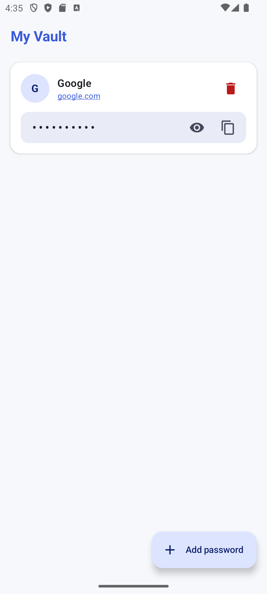
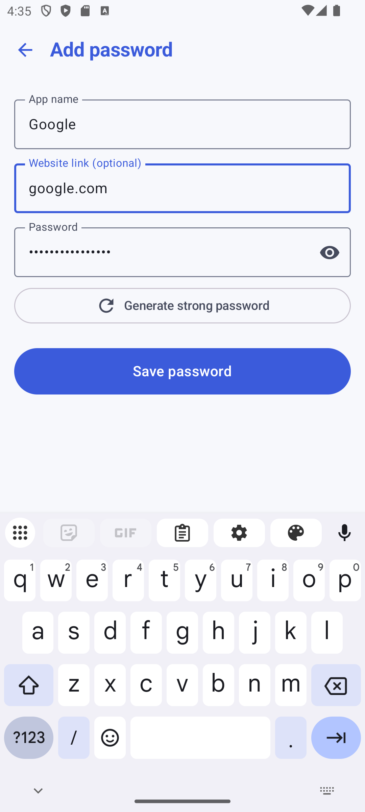

# Vault

An offline Android password manager that lives entirely on your phone. Generate strong passwords, save them with the app name and website link, keep them hidden until you tap the eye icon, and copy them with one tap. No account, no internet, no server.

Built with **Kotlin**, **Jetpack Compose** and **Material 3**.

## Screenshots

<p align="center">
  
  &nbsp;&nbsp;&nbsp;
  
</p>

## Features

- **Password generator**: one tap creates a strong 16-character password using `SecureRandom`
- **Save passwords** with an app name and an optional website link
- **Hidden by default**: passwords show as dots until you tap the eye icon
- **Copy to clipboard**: one tap copies a password (flagged as sensitive on Android 13+)
- **Open websites** directly from a saved entry
- **Delete with confirmation** so nothing is removed by accident
- **Saved on the device**: entries are still there after closing the app
- **Light and dark mode**, following your phone's setting
- **Form validation** with clear error messages for required fields
- **Friendly empty state** when nothing is saved yet

## Tech stack

| Area | Choice |
|---|---|
| Language | Kotlin |
| UI | Jetpack Compose, Material 3 |
| Architecture | Single-activity, state hoisting |
| Storage | SharedPreferences (JSON) |
| Randomness | `java.security.SecureRandom` |
| Icons | Material Icons Extended |

## How it works

- **One activity**: `MainActivity` hosts the whole app. A top-level `VaultApp` composable holds the shared list and decides whether to show the vault or the add form.
- **State hoisting**: the password list lives in `VaultApp` and is passed down to the screens, so both read and write the same data.
- **Persistence**: every add or delete saves the list to a small private file on the device, and the list is loaded again when the app starts.
- **Screens**: `YourVaultScreen` shows the saved entries in a `LazyColumn`, and `AddPasswordScreen` is the form.
- **Navigation**: the system back button on the add screen returns to the vault.

## Getting started

1. Clone the repository:
   ```
   git clone https://github.com/YOUR-USERNAME/Vault.git
   ```
2. Open the project in **Android Studio**.
3. Let Gradle sync finish.
4. Run the app on an emulator or a connected Android phone.

## Limitations

This is a learning project, so please don't store real banking or email passwords in it.

- Passwords are saved on the device but are **not encrypted**
- There is **no app lock** (PIN or fingerprint)
- There is no edit option yet

## Roadmap

- [ ] Encrypt stored passwords with the Android Keystore (AES-GCM)
- [ ] Add a fingerprint or PIN lock
- [ ] Edit saved entries
- [ ] Search
- [ ] Move to Room, ViewModel and Navigation Compose
